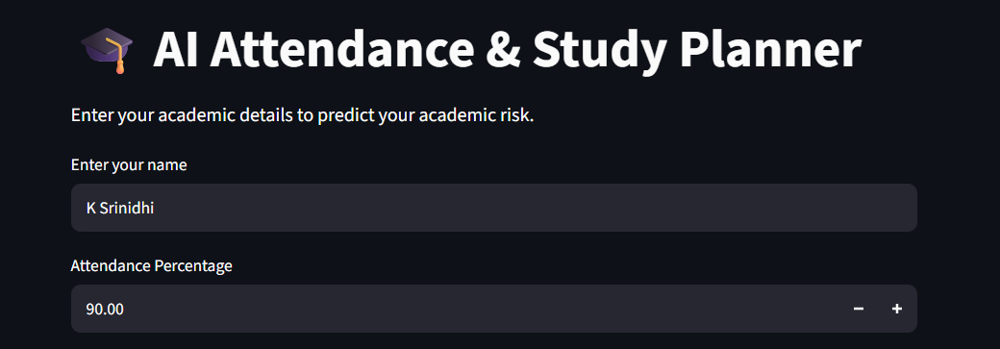
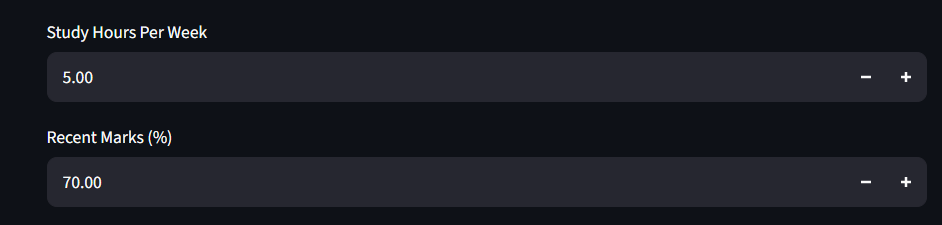
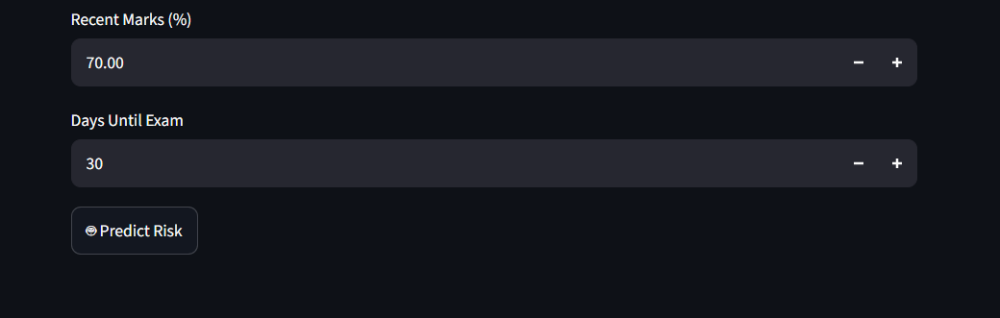

# 🎓 AI Attendance & Study Planner

## 📌 Project Overview

AI Attendance & Study Planner is an AI-based application that helps students
manage their attendance and study schedules.

The system takes student information as input and provides useful predictions
or suggestions to help students plan their studies effectively.

## 🚀 Features

- 📊 Attendance tracking
- ⚠️ Attendance status prediction
- 📚 Study planning
- ⏰ Study schedule management
- 🤖 AI-based suggestions
- 📈 Student progress monitoring

## 🖥️ Project Screenshots

### 1. Attendance Dashboard



### 2. Study Planner



### 3. AI Result



## 🛠️ Technologies Used

- Python
- Streamlit
- Machine Learning
- Pickle
- Pandas

## ▶️ How to Run

Install the required libraries:

```bash
pip install streamlit pandas scikit-learn